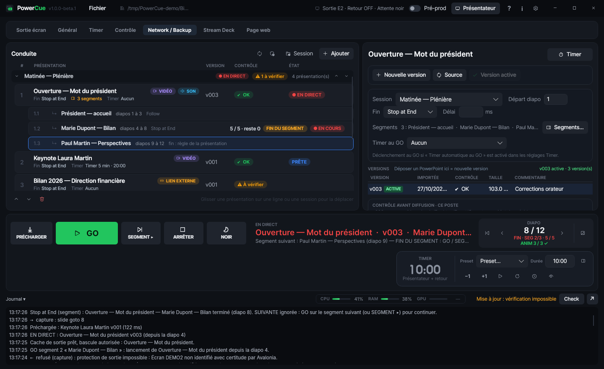
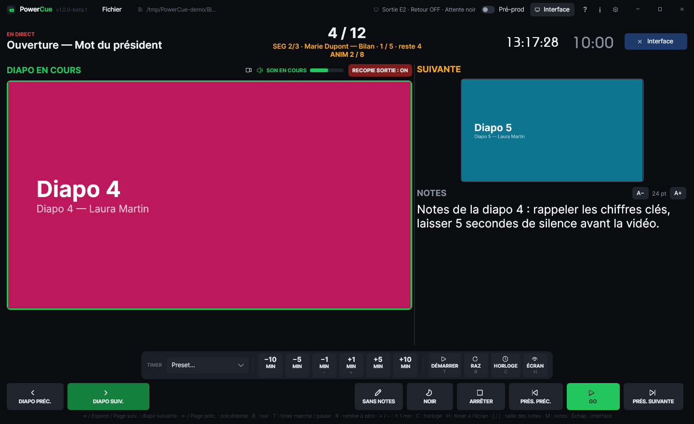

<p align="center">
  
</p>

<h1 align="center">PowerCue</h1>

<p align="center">
  <b>Régie de présentations PowerPoint et Keynote en direct — Windows &amp; Mac</b><br>
  <i>Live PowerPoint and Keynote playback for events — Windows &amp; Mac</i>
</p>

<p align="center">
  <a href="https://github.com/VideoBridgeSolutions/VBS-PowerCue/releases"></a>
  
  
  
</p>

<p align="center">
  
</p>

**🇫🇷 [Français](#français) · 🇬🇧 [English](#english)**

> [!WARNING]
> **Version bêta.** PowerCue n'est pas encore validé pour la production. Gardez toujours une solution de secours (PowerPoint lancé à la main sur un autre poste) tant qu'il n'a pas été validé sur deux postes réels avec PowerPoint / Keynote et leurs sorties vidéo.
> **Beta version.** PowerCue is not yet validated for production. Always keep a fallback until it has been validated on two real computers with PowerPoint / Keynote and their video outputs.

---

## Français

PowerCue enchaîne des présentations PowerPoint et Keynote pendant un événement, **sans jamais montrer le bureau au public**. L'opérateur prépare une conduite, contrôle chaque fichier avant le direct, lance chaque présentation d'un GO, et peut doubler la régie avec un poste Backup qui rejoue la diffusion en miroir.

### Fonctions

- **Conduite** en sessions, avec **versions** (v001, v002…) et copie locale de chaque fichier et de ses médias : rien n'est diffusé depuis une clé USB.
- **Contrôle avant diffusion** : polices manquantes (assistant de recherche USB / dossier / Téléchargements / Google Fonts et installation sans droits admin), médias liés, liens externes. Le GO est bloqué tant qu'un manque n'est pas résolu ou explicitement accepté.
- **GO sans bureau visible** : écran d'attente (noir ou image), délai de stabilisation, NOIR, fin **Stop at End** ou **Follow**, préchargement.
- **Segments** : plusieurs intervenants dans une même présentation, avec Stop at End entre eux et décompte de diapos par segment.
- **Mode Présentateur** plein écran : diapo en cours, suivante, notes, timer, heure. Compteur d'animations **ANIM 2 / 8**, recopie en direct de la sortie (vidéos visibles), indicateur de son avec vumètre.
- **Écran retour** (notes, diapo suivante, recopie) et **timer** (compte à rebours, chronomètre, horloge, jusqu'à une heure, presets).
- **Snapshot** de la diapo en cours : PNG, image d'attente, ou fond d'écran du bureau de l'écran de sortie.
- **Télécommandes** : cliqueur USB, raccourcis globaux, pages web `/command` `/presenter` `/return`, API HTTP pour Bitfocus Companion, **Stream Deck** en USB direct.
- **Redondance Main / Backup en miroir** : le Backup rejoue chaque GO, diapo, animation, segment, NOIR et timer du Main ; reprise manuelle uniquement, jamais de bascule automatique.
- **Mises à jour** depuis les Releases GitHub, paquet vérifié par SHA-256, refusées pendant un direct.

| | Windows | Mac |
|---|---|---|
| PowerPoint | ✅ | ✅ |
| Keynote | — | ✅ |
| Compteur d'animations, vumètre | ✅ PowerPoint | — |
| Recopie de la sortie en mode Présentateur | ✅ | ✅ PowerPoint uniquement |
| Fond d'écran depuis un snapshot | ✅ écran de sortie | ✅ (autorisation Automatisation) |

### Installation

Téléchargez la dernière version dans **[Releases](https://github.com/VideoBridgeSolutions/VBS-PowerCue/releases)**.

- **Windows 10 / 11 (x64)** : `PowerCue-<version>-win-x64-Setup.exe`. Non signé pour l'instant : SmartScreen › « Informations complémentaires » › « Exécuter quand même ». L'installateur autorise PowerCue dans le pare-feu Windows.
- **macOS (Apple Silicon / Intel)** : `PowerCue-<version>-osx-arm64.dmg` ou `-osx-x64.dmg`, glisser dans Applications. Non notarisé : Réglages Système › Confidentialité et sécurité › « Ouvrir quand même ». Autorisez ensuite le contrôle de PowerPoint / Keynote (Automatisation) et, pour les raccourcis globaux, l'Accessibilité.

Prérequis : PowerPoint (Microsoft 365 ou 2019+) et / ou Keynote, un écran d'interface et une sortie vidéo dédiée. Réseau câblé conseillé pour le Main / Backup.

### Documentation

- 📘 **[Manuel utilisateur FR / EN (PDF)](docs/PowerCue_Manuel_v1.0.0-beta.1_FR-EN.pdf)**, aussi joint à chaque Release.
- [Guide opérateur Main / Backup](MAIN_BACKUP_OPERATOR_GUIDE.md)
- [Notes de la version bêta.1](CHANGELOG_BETA1.md) · [Notes de release](RELEASE_NOTES_v1.0.0-beta.1.md) · [Historique des alpha](docs/HISTORIQUE_ALPHA.md)

<p align="center"></p>

### Signaler un bug

Dans le groupe WhatsApp des testeurs ou via une *issue* : version (barre de titre), Windows ou Mac, version d'Office / Keynote, ce que vous avez fait, ce qui s'est passé, l'heure, et le **journal du jour** (`%APPDATA%\PowerCue\logs\` ou `~/Library/Application Support/PowerCue/logs/`). Le journal ne contient ni mot de passe ni PIN.

---

## English

PowerCue runs PowerPoint and Keynote presentations back to back during live events, **without ever showing the desktop to the audience**. The operator builds a running order, checks every file before the show, starts each presentation with a single GO, and can add a Backup computer that mirrors the playback.

### Features

- **Running order** in sessions, with **versions** (v001, v002…) and a local copy of every file and its media: nothing is played from a USB stick.
- **Pre-show check**: missing fonts (search assistant on USB / folder / Downloads / Google Fonts, install without admin rights), linked media, external links. GO is blocked until a gap is fixed or explicitly accepted.
- **GO with no visible desktop**: standby screen (black or image), settling delay, BLACK, **Stop at End** or **Follow** ending, preload.
- **Segments**: several speakers in one presentation, with Stop at End between them and a per-segment slide countdown.
- **Full-screen Presenter mode**: current slide, next slide, notes, timer, clock. **ANIM 2 / 8** animation counter, live output mirror (videos visible), sound indicator with level meter.
- **Confidence screen** (notes, next slide, mirror) and **timer** (countdown, count up, clock, until a time, presets).
- **Snapshot** of the current slide: PNG, standby image, or desktop wallpaper of the output screen.
- **Remotes**: USB clicker, global shortcuts, `/command` `/presenter` `/return` web pages, HTTP API for Bitfocus Companion, direct-USB **Stream Deck**.
- **Main / Backup mirror redundancy**: the Backup replays every GO, slide, animation, segment, BLACK and timer of the Main; manual takeover only, never automatic failover.
- **Updates** from GitHub Releases, package verified by SHA-256, refused during a show.

The interface is in French; the Network / Backup tab is also available in English. The user manual is bilingual.

### Installation

Download the latest build from **[Releases](https://github.com/VideoBridgeSolutions/VBS-PowerCue/releases)**.

- **Windows 10 / 11 (x64)**: `PowerCue-<version>-win-x64-Setup.exe`. Not signed yet: SmartScreen › "More info" › "Run anyway". The installer allows PowerCue through the Windows firewall.
- **macOS (Apple Silicon / Intel)**: `PowerCue-<version>-osx-arm64.dmg` or `-osx-x64.dmg`, drag to Applications. Not notarized: System Settings › Privacy & Security › "Open Anyway". Then allow control of PowerPoint / Keynote (Automation) and, for global shortcuts, Accessibility.

Requirements: PowerPoint (Microsoft 365 or 2019+) and / or Keynote, one interface screen and a dedicated video output. Wired network recommended for Main / Backup.

### Reporting a bug

In the testers' WhatsApp group or as an issue: version (title bar), Windows or Mac, Office / Keynote version, what you did, what happened, the time, and the **daily log** (`%APPDATA%\PowerCue\logs\` or `~/Library/Application Support/PowerCue/logs/`). The log never contains passwords or PINs.

---

## Build from source

Requires the **.NET 8 SDK**. Avalonia 11.3, C#.

```bash
dotnet build PowerCue.sln -c Release
dotnet run --project tests/PowerCue.Tests -c Release   # tests automatiques / automated tests
```

| Target | Script | Output |
|---|---|---|
| Windows app | `build.bat` | `out/win-x64/PowerCue.exe` |
| Windows installer | `build-installer-win.bat` (NSIS: `winget install NSIS.NSIS`) | `out/installers/PowerCue-<version>-win-x64-Setup.exe` |
| macOS app | `build-mac.sh` / `Construire PowerCue (Mac).command` | `.app` signed locally |
| macOS + Windows installers | `build-installers-mac.sh` | `.dmg` + `Setup.exe` |

```
src/PowerCue.Core       conduite, contrôle, ShowController, CommandRouter, Main/Backup, serveur web
src/PowerCue.Platform   PowerPoint COM (Windows), PowerPoint / Keynote AppleScript (Mac), écrans, audio
src/PowerCue.App        interface Avalonia, mode Présentateur, sorties, Stream Deck
tests/PowerCue.Tests    tests automatiques
```

---

<p align="center">
  <b>Video Bridge Solutions</b> · <a href="https://www.videobridgesolutions.com/powercue">videobridgesolutions.com/powercue</a><br>
  © 2026 Video Bridge Solutions
</p>
